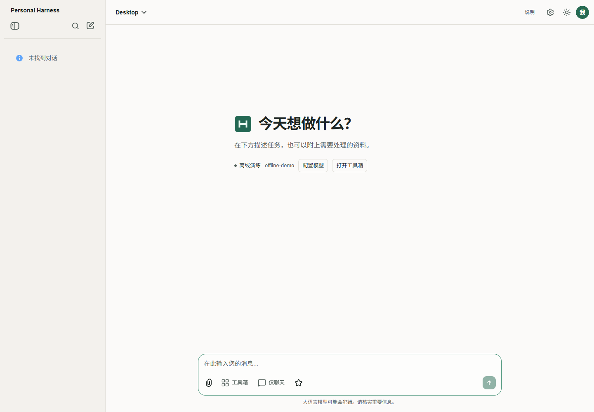

# Personal Harness

[在线文档](https://wuyuewy.github.io/Personal-Harness/) · [综合任务演示](https://wuyuewy.github.io/Personal-Harness/#task-demo) · [下载版本](https://github.com/WuYuewy/Personal-Harness/releases) · [反馈问题](https://github.com/WuYuewy/Personal-Harness/issues)

[](https://github.com/WuYuewy/Personal-Harness/actions/workflows/ci.yml)

一个围绕你的使用方式配置的轻量 Personal Agent。把重复的确定性任务留在本地，把模型用在需要理解和生成的地方。

**省钱 · SDK 效率 · 精简抽象 · 用户个性化**

基于 PydanticAI 执行，Chainlit 提供可选的聊天界面。Apache-2.0，Python 3.12+。当前版本：**0.1.0**。

## 5 分钟开始

安装 [Git](https://git-scm.com/downloads) 和 [uv](https://docs.astral.sh/uv/getting-started/installation/)，然后运行：

```sh
git clone https://github.com/WuYuewy/Personal-Harness.git
cd Personal-Harness
uv sync --locked --extra ui
uv run personal-harness init
uv run personal-harness ui
```

浏览器打开 http://127.0.0.1:8000 。首次使用用户名 `local`，输入自己设置的至少 8 位密码。随后打开 **配置模型**，填写你自己的 OpenAI 兼容 API 地址、模型 ID、Key、上下文上限和价格，保存后发送 `/test-model`。

项目不附带模型服务或 API Key。初始配置是零联网的配置演练；连接模型之后才会执行真实智能任务。价格按人民币/百万 Token 填写，外币价格需自行换算。

## 可以做什么

- **持续的多聊天**：侧栏切换、恢复历史、文本/PDF 附件、导出、工具执行进度、可选流式回复。
- **电脑协作**：授权工作区后搜索、按页读取、批量只读、生成文件，所有文件写入先看差异再审批。
- **本地直达**：搜索、CSV 精确查找/汇总、带标记待办、个人简报方案、地点筛选，无需模型请求。
- **自己的助手**：账号级语气、详略、格式和成本偏好；独立场景及快捷查询；可查看、修改和删除的长期偏好及使用图表。
- **成本可查**：逐请求账本、预算预检、失败与未知费用、模型调用次数、每轮费用收据、本地任务计数。

## 省在哪里

Harness 通过本地执行、范围明确的检索/读取、工具选择、历史文件引用和复用运行资源减少不必要的模型工作；不会把供应商缓存折扣宣传为本项目的节省。实际收益依赖任务，未承诺统一节省百分比。[成本说明](https://wuyuewy.github.io/Personal-Harness/#savings)列出每项机制、衡量方式和边界。

## 在线文档

使用文档已部署到 **[GitHub Pages](https://wuyuewy.github.io/Personal-Harness/)**，无需启动本地文档服务。覆盖首次登录、模型配置、各项功能、四项目标的实现与边界，以及 SDK 和维护流程。

[快速开始](https://wuyuewy.github.io/Personal-Harness/#getting-started) · [个性化](https://wuyuewy.github.io/Personal-Harness/#personalization) · [省钱机制](https://wuyuewy.github.io/Personal-Harness/#savings) · [功能边界](https://wuyuewy.github.io/Personal-Harness/#limits)



## SDK

```python
import asyncio
from personal_harness import Agent


async def main():
    async with Agent.from_config("personal-harness.toml") as agent:
        result = await agent.run(
            "总结项目资料，标出来源", tools=["workspace.search", "workspace.read"]
        )
        print(result.output)


asyncio.run(main())
```

先在 TOML 中配置在线模型、预算及工具权限。UI 保存的模型连接存于本地 UI 数据库，**不会自动写进 SDK 的 TOML**。涉及写入时需处理 `pending_approval`，见 [SDK 文档](https://wuyuewy.github.io/Personal-Harness/#sdk)。

## 项目结构

```text
src/personal_harness/   执行引擎、配置、预算、工具和可选 UI
examples/               可运行示例与综合任务资料
tests/                  离线回归测试
docs/                   文档 Markdown 源文件
docs/site/              GitHub Pages 静态站、截图与示例下载
scripts/                文档构建、审计和安装后冒烟检查
.github/workflows/      Windows/Linux CI 与 Pages 自动部署
```

## 开发与交付

```sh
uv sync --locked --extra ui --dev
uv run ruff check .
uv run ruff format --check .
uv run mypy
uv run --extra ui pytest
uv run python scripts/build_docs.py --check
uv build
uv run python scripts/smoke_wheel.py
uv run python scripts/smoke_wheel.py --ui
uv run python scripts/audit_release.py --tree .
```

[维护指南](https://wuyuewy.github.io/Personal-Harness/#maintenance) · [产品范围](docs/PRODUCT_SCOPE.md) · [变更记录](CHANGELOG.md) · [贡献指南](CONTRIBUTING.md) · [安全说明](SECURITY.md)

首版面向个人本地运行。手机通过浏览器访问同一服务；不含原生应用、通用 Shell、任意浏览器自动化、实时地图服务或扫描 PDF OCR。请只授权需要的文件目录。
