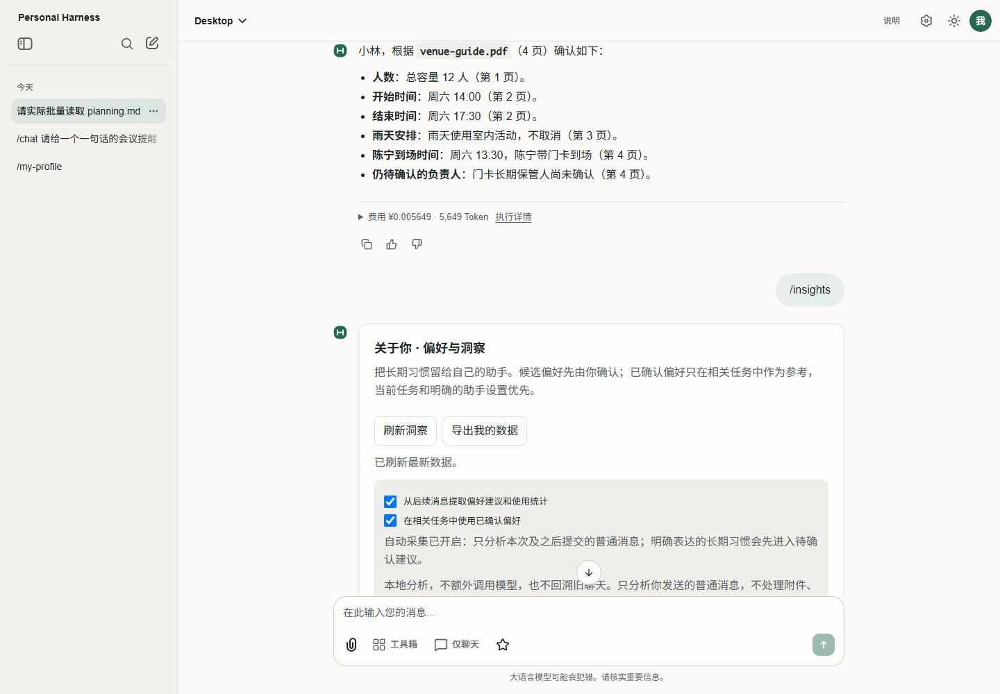

# 聊天、附件与执行进度

## 多聊天与连续上下文

侧栏支持新建、搜索、重命名、删除和切换聊天。默认携带最近 12 轮、总计最多 48000 UTF-8 字节的完整历史轮次；展示历史与发送给模型的上下文是两回事。

用 `/context` 查看上下文范围；`/clear` 清除后续模型上下文但保留界面记录；`/export` 下载 Markdown 聊天。删除聊天也会移除该聊天的统计和待确认偏好，已确认的长期偏好需单独删除。

## 文本与 PDF

支持 UTF-8 文本、代码、JSON、CSV 和可提取文字的 PDF。单次最多 5 个附件、每个上传上限 100 MB；本地单文件与批量读取默认上限 100 MiB。PDF 先在本地抽取文字再发给模型，不支持扫描件 OCR、图片理解或保真表格重建。

附件内容不自动进入工作区。文件足够小可以完整上传，不代表模型能接受全部文字；上下文容量、输出预算和网关限制仍然适用。上一轮附件超过当前历史容量时，系统会先让你选择取消调高容量，或仅用本轮内容继续，避免悄悄丢失资料。

图中资料为公开的虚构演示，完整流程见[综合任务演示](task-demo.md)。上传附件用回形针；侧栏切换历史不会把另一聊天的附件混入当前对话。

## 等待、流式回复与停止

运行状态以原生折叠步骤显示准备上下文、等待模型、执行工具和完成。步骤默认收起，可按需查看；它展示执行状态，不公开模型隐藏推理。停止按钮取消活动任务并关闭客户端，正在等待审批的变更不会执行。

流式回复可在设置开启；如果供应商未返回可信 usage，费用保留为未知。备用模型升级与流式回复不同时使用。

## 模型管理

`/models` 新增、编辑、删除连接；`/test-model` 验证当前选择。删除正在使用的连接后不会悄悄改用另一模型，需要你重新选择。模型参数与权限可按聊天保存，账号级体验偏好保持一致。
