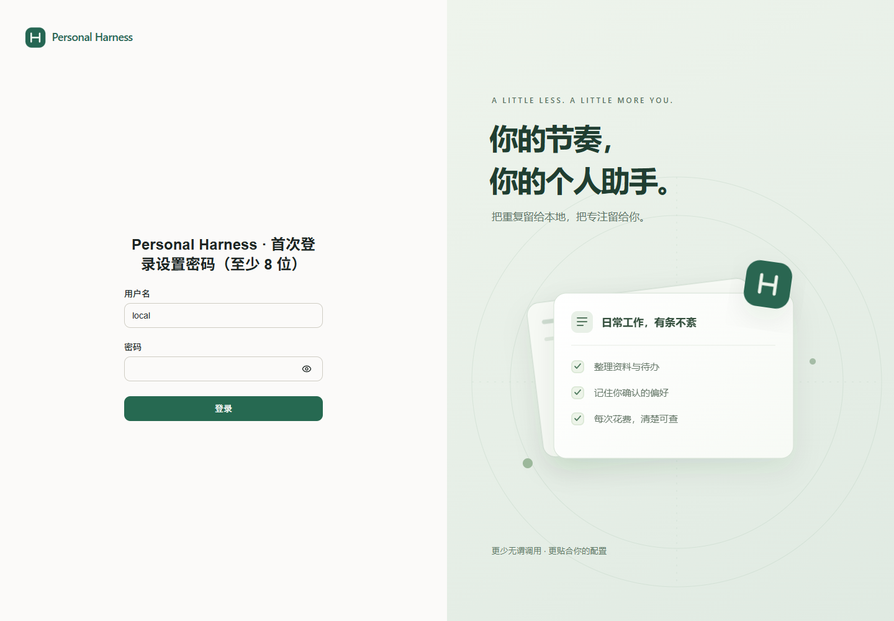
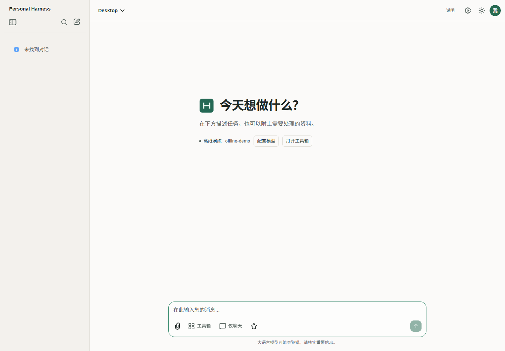
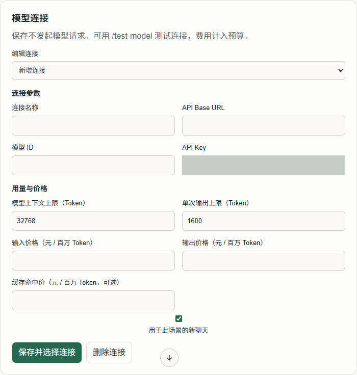

# 从首次登录到第一个任务

## 安装与启动

需要 Python 3.12+、Git 和 [uv](https://docs.astral.sh/uv/getting-started/installation/)。从公开仓库下载并启动：

```sh
git clone https://github.com/WuYuewy/Personal-Harness.git
cd Personal-Harness
uv sync --locked --extra ui
uv run personal-harness init
uv run personal-harness ui
```

如果本机存在失效的 Python 安装或注册项，可在 `uv sync` 后追加 `--python` 并指定一个有效的 Python 3.12+ 可执行文件；不要依赖旧项目的虚拟环境路径。

打开 http://127.0.0.1:8000 。首次登录的用户名为 `local`，密码由你现场设置，至少 8 位。以后用相同密码登录。首次只绑定本机地址；共享到其他设备前，先在本机完成密码设置。

Agent 首次打开默认使用明亮模式；你可以在界面菜单中切换主题，选择会保留在当前浏览器中。





配置文件 `personal-harness.toml`、聊天数据库和上传文件都留在运行目录，不属于应提交的源码。

## 连接你自己的模型

点击欢迎卡中的「配置模型」，或发送 `/models`。填写连接名称、API Base URL（通常以 `/v1` 结尾）、模型 ID、API Key、上下文上限、单次输出上限，以及输入和输出价格。

价格单位为 **元 / 百万 Token**。缓存命中价格可以留空，此时使用普通输入价。请核实服务商价格；账本按你填写的价格计算，不代表服务商最终账单。没有内置供应商、模型列表或可用密钥。

点击「保存并选择连接」。保存本身不调用模型，Key 输入框随后清空。输入 `/test-model` 发送一次真实的最小请求；该请求也计入预算。



上图是首次打开的实际空白表单。连接名称由你命名；API 地址、模型和价格均按服务商说明填写，项目没有机构专用的填参按钮。

## 第一个真实任务

直接输入「请用三点说明怎样安排一次项目周会」，或上传自己的文本/PDF，再输入 `/chat 请总结附件中的主要结论`。后一种只提供聊天和附件，不开放工具。

等待时可展开执行进度；模型完成后显示回复和费用收据。可选 SSE 流式输出在设置 → 费用与上下文开启，需要服务商返回标准用量。

## 第一个文件任务

在设置 → 个人助手设置一个专用工作目录。在「工具」授权 `workspace.list`、`workspace.search`、`workspace.read`、`workspace.write_preview`、`workspace.write`。保存后再打开设置，选择下一轮实际要用的工具。

在该目录创建 `notes.md`：

```text
预算：3000 元
已支出：1200 元
TODO: 林同学周五提交检索模块
TODO: 周同学周四提交权限模块
```

输入「读取 notes.md，生成一份带来源的项目简报，写到 brief.md」。检查完整正文和差异，点击 **Apply write** 才会落盘；**Reject** 拒绝写入。模型行为依赖所选模型的工具调用能力。

## 下次打开

侧栏恢复原聊天；新建聊天开始独立上下文。模型连接可设为当前场景的新聊天默认值，`/save-defaults` 保存其他场景设置。账号级助手偏好自动应用于该账号所有聊天。

接下来可跟随[综合任务演示](task-demo.md)，用公开示例资料完成本地核账、在线多文件分析、写入审批、下载和个人方案复用。
