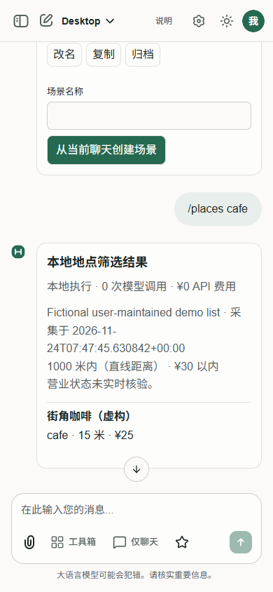

# 手机与本地生活



图中按用户配置的价格上限筛选，本机完成、0 次模型请求。它没有接入实时地图，地点营业状态需要另行核实。

## 手机入口

手机浏览器访问电脑上的同一 UI 服务，聊天、配置和账本在电脑端保存。先在本机设置登录密码，再绑定合适的局域网地址；默认只监听 127.0.0.1。不含手机原生客户端或手机本地模型运行。

```sh
uv run personal-harness ui --host 0.0.0.0 --port 8000
```

只在信任的网络运行；跨公网需要你自行部署 HTTPS、访问控制和反向代理。本项目的本地密码登录不是多租户托管平台。

## 地点数据由你控制

在设置 → 本地生活中填写自己维护的 JSON 数据文件、确认的 WGS84 位置、距离、价格和有效期。为聊天授权 `places.search` 后，可用 `/places cafe` 或工具箱本地筛选。

```json
{
  "schema_version": 1,
  "source": "我的地点清单",
  "fetched_at": "2026-11-24T08:00:00Z",
  "city": "示例城市",
  "places": [{
    "id": "cafe-1", "name": "街角咖啡", "category": "cafe",
    "latitude": 31.2305, "longitude": 121.4738,
    "price_cny": "25", "open_status": "unknown"
  }]
}
```

数据时间应是实际采集时间。只进行直线距离、价格和类别过滤，保留来源时间；过期、未来时间和未知营业状态都会标示。设置价格上限时排除价格未知的地点。

## 能力边界

不内置实时地图供应商，不自动获取 GPS，不保证营业状态，不提供导航、订餐或支付。用户维护的数据可真实使用，但不等于联网搜索。需要解释和比较时，在线 Agent 可以调用同一地点工具，再生成文字建议；简单筛选可以完全不调用模型。
