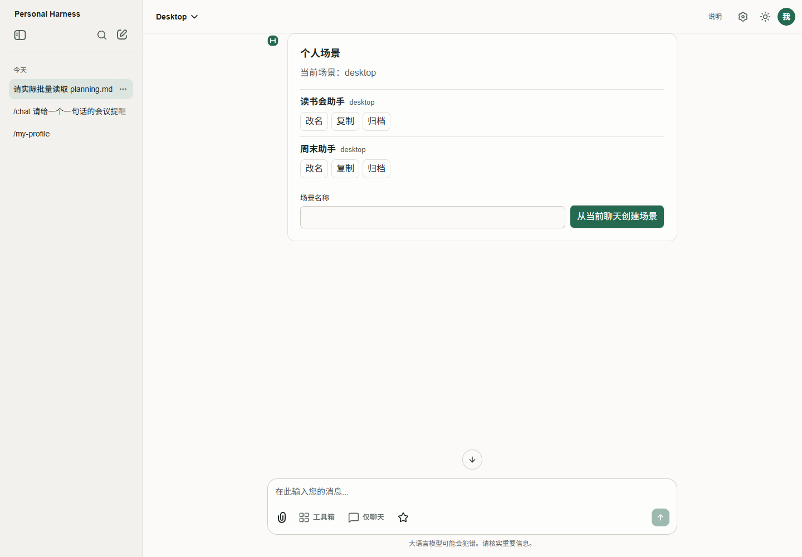
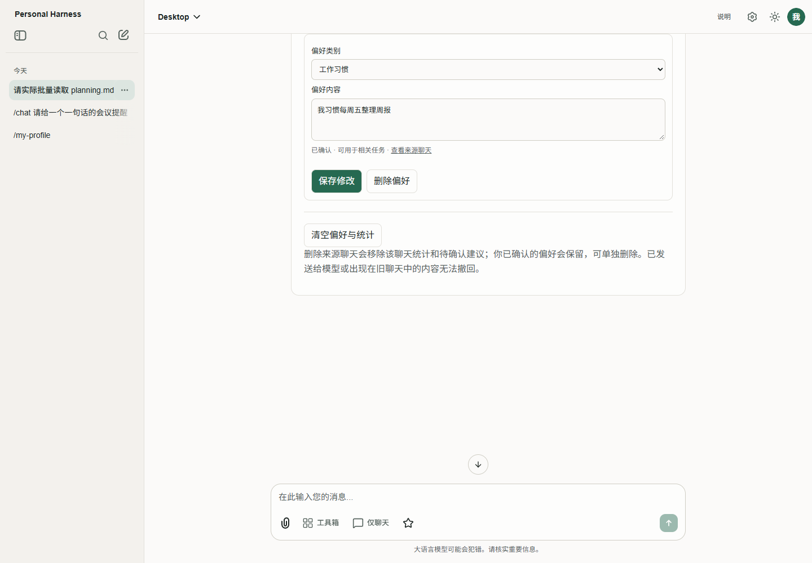
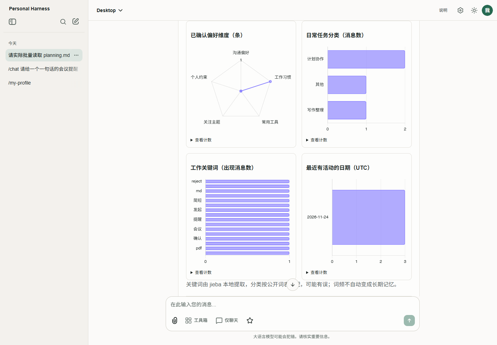

# 让助手适应你

## 三层个性化

| 层次 | 配置内容 | 生效范围 |
| --- | --- | --- |
| 账号级「我的助手」 | 称呼、语气、详略、回答格式、澄清习惯、主动性、来源、成本取舍、补充偏好 | 账号的所有聊天 |
| 个人场景 | 工作区、工具授权、模型、预算、快捷查询、基础 profile | 该场景的新聊天 |
| 用户偏好记忆 | 你确认的长期习惯、常用工具、关注主题、约束 | 相关任务的有界上下文 |

当前任务与明确的助手设置优先。记忆不改变权限和预算，也不会自动替你配置外部服务。

## 查看与修改

设置 →「我的助手」保存账号偏好。`/my-profile` 查看有效配置。`/scenes` 从当前聊天创建个人场景，支持复制、改名、归档和恢复。`/save-defaults` 更新当前场景的后续聊天默认值。

归档不会删除历史，已归档场景不能新开任务；删除模型连接需要重新选择可用连接。设备变化不会扩大工具权限。

## 偏好与洞察

`/insights` 手动添加长期偏好，或开启「从后续消息提取偏好建议和使用统计」。默认关闭自动采集，开启后只分析后续普通用户消息，不回溯历史，不分析附件或工具结果。

例如「我习惯每周五整理周报」会成为待确认建议。只有点击「确认采用」才作为后续参考。临时任务、引用和包含敏感信息的文本不会随意变成长效偏好。分析使用本地规则和 jieba，不增加模型调用。

「使用画像」展示已确认偏好维度、任务分类、关键词和日期频次。这里是实际计数，不是人格评分。可查看计数、导出、编辑、删除或清空。

截图中的数据来自短时验收演示，不是长期使用效果或人格评估。

## 定向适配

电脑场景强调项目工作区、来源和书面产物；手机场景强调简短回答、结构化地点条件和本地筛选。它们复用同一个 SDK，主要差异来自你的配置。城市只是可选查询条件，不能代表整个个性化方案。
