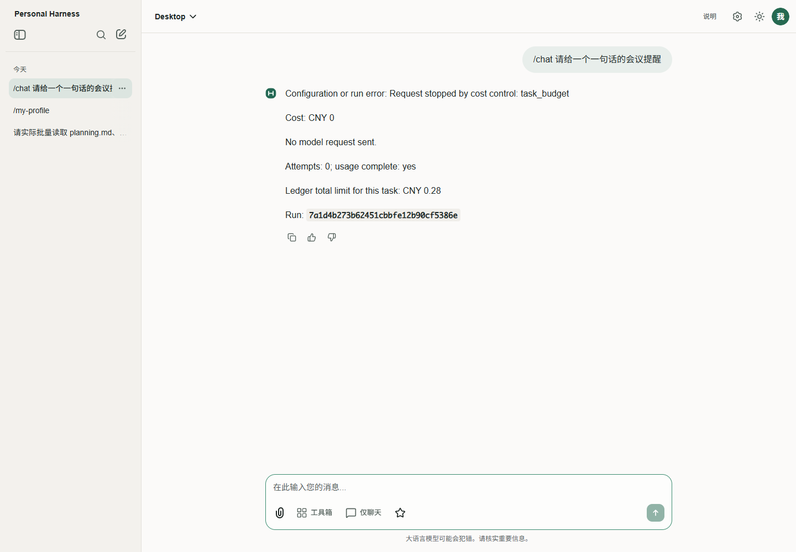

# Harness 如何省钱

## 先看结果，再看费用

只有满足同一任务验收条件时，减少的调用和 Token 才有意义。不能只比较一次便宜的失败运行；重试、升级、失败开销都计入同一账本。首版提供具体机制和可核验记录，不承诺任何统一的节省比例。

## Harness 自己完成的优化

| 机制 | 具体实现 | 用户如何看见 | 限制 |
| --- | --- | --- | --- |
| 本地直达 | CSV、待办、搜索、地点筛选绕过模型 | 结果写明 0 次模型请求、¥0 API 费用 | 只做确定性运算 |
| 个人任务方案 | 按用户定义前缀生成可审批简报 | 运行次数、来源、零请求收据 | 不进行语义改写 |
| 按需工具与上下文 | 限制本轮工具、可选 task 上下文模式 | 设置、运行工具和上下文记录 | 不保证每次更便宜 |
| 文件结果分页 | 只返回配置范围的片段，标示续读位置 | 可展开工具结果 | 模型可能需要多次读取 |
| 历史文件引用 | 较早的大文件正文替换成来源引用 | 收据中的省略字节数与上下文状态 | 必要时需重新读取 |
| 预算与循环约束 | 每次发送前占用额度，限制步骤、工具调用和重试 | `/budget`、逐请求账本 | 保守预留可能阻止实际上便宜的请求 |
| 有限升级 | 用户显式配置，只有 length 截断升级一次 | 两个模型的费用都累计 | 不是自动质量评分器 |

历史文件引用默认跟随成本偏好：省钱优先使用 references，平衡和质量优先保留 full；用户可覆盖。引用模式仅精简符合条件的较早大文件读取，保留最近一轮和必要来源。完整会话在本地保留。

## SDK 效率不是 Token 折扣

同一聊天复用 Agent、HTTP 客户端与有界读取缓存；文件工具可批量、只读可并发，减少构建开销和串行等待。缓存校验文件身份和变化，工具权限变化仍会重查。`read_cache_bytes` 默认 0，需自行开启。

这些可减少本地 IO 和延迟，**不代表模型输入自动变少**。直接读取缓存与供应商 Prompt Cache 是不同机制。

## 不把供应商缓存算成自己的功劳

账本可以按你填写的缓存价格计算实际估算费用，单列缓存价差。该折扣来自供应商。本项目不把缓存命中带来的便宜记为 Harness 自身节省，也不从省略字节数伪造节省金额。

## 计费、预留与未知

在线费用为可信 usage × 用户价格，人民币 Decimal 计算。缺失或矛盾 usage、发送后断线等保留未知，阻止继续掩盖风险。明确未建连的失败记录为零；HTTP 429 本身不保证免费。

每次请求保守预留按模型完整上下文上限和输出上限计算。因此即使短任务实际只用几厘钱，也可能要求更大的可用预算。单轮、UTC 每日和可选累计上限共用本地账本。

用 `ledger list` 和 `ledger show` 查看记录。核实账单后才能 `ledger reconcile --amount-cny ... --source ...`；不把未知费用自动当零。请求前预留不是账单。

图中 `task_budget` 表示单轮上限阻止了请求，不是网关失联。`daily_budget`、`total_budget` 分别对应每日和累计可用额度；请同时检查三个上限。即使实际费用很低，扣除已有费用后的余额也必须容纳下一次保守预留。具体费用与本地零请求步骤可在[综合任务演示](task-demo.md)中对照。
