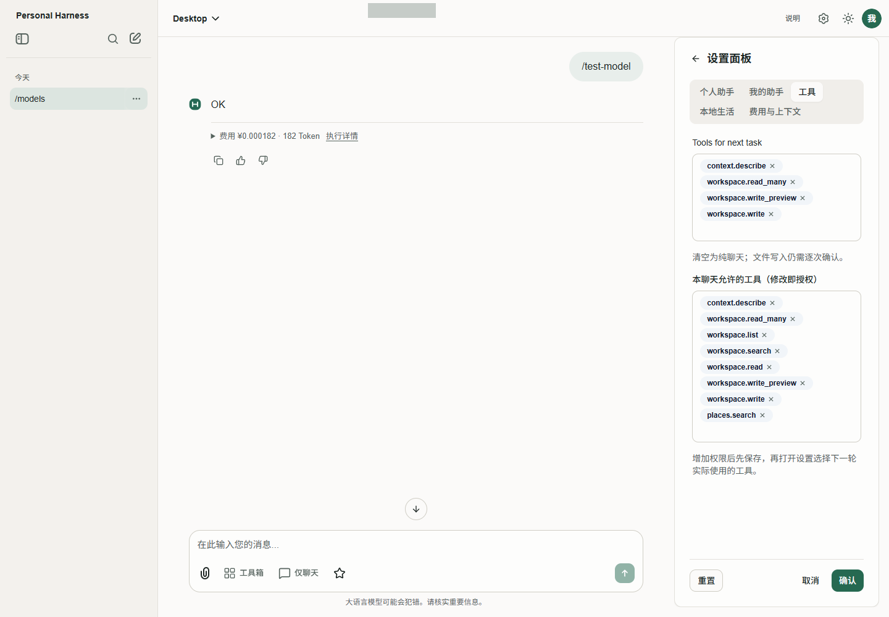
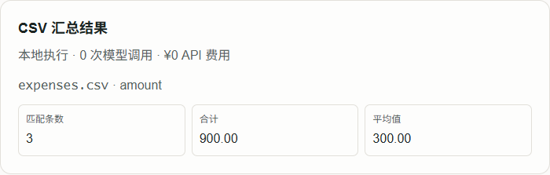
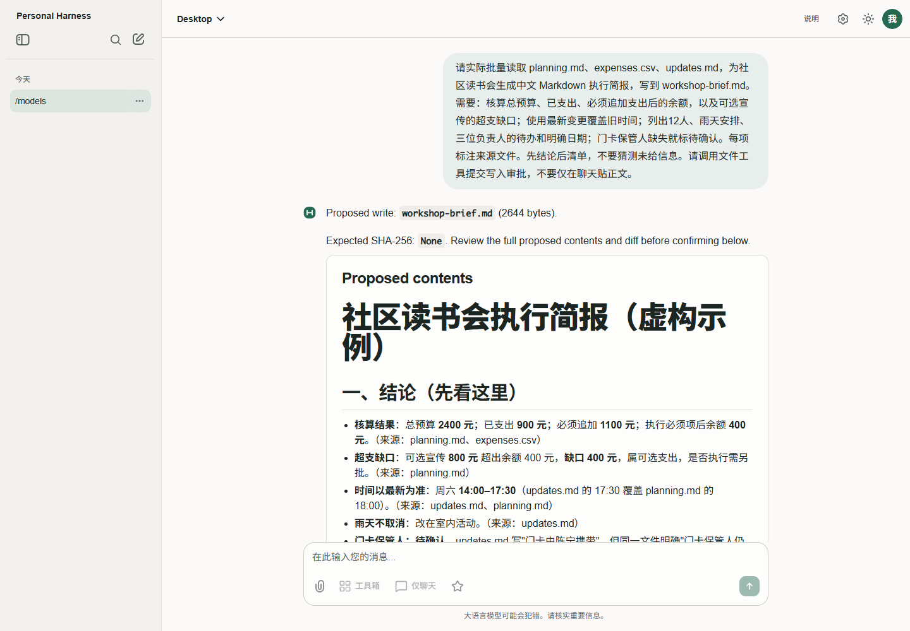
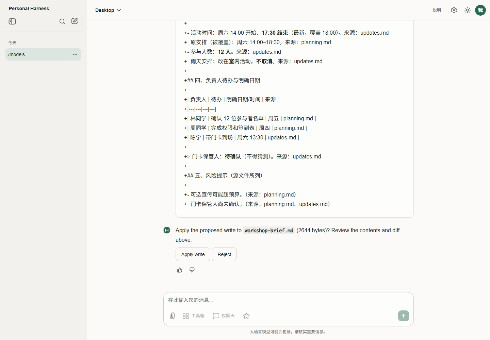
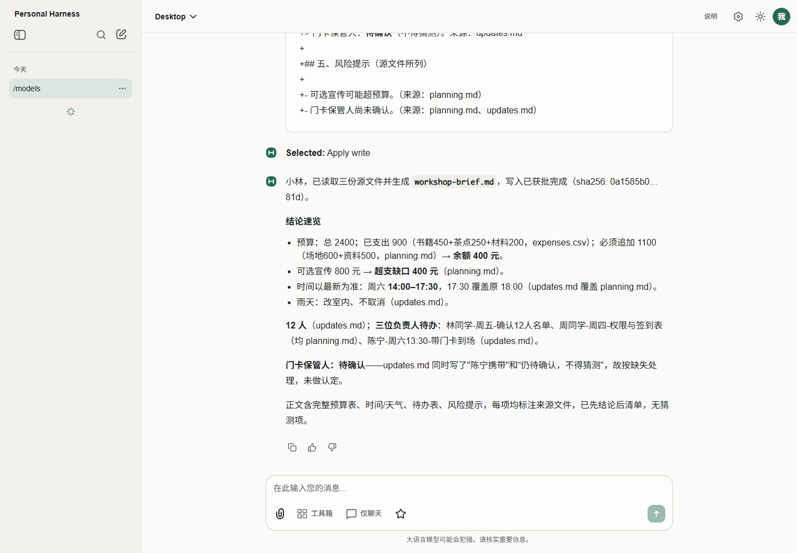
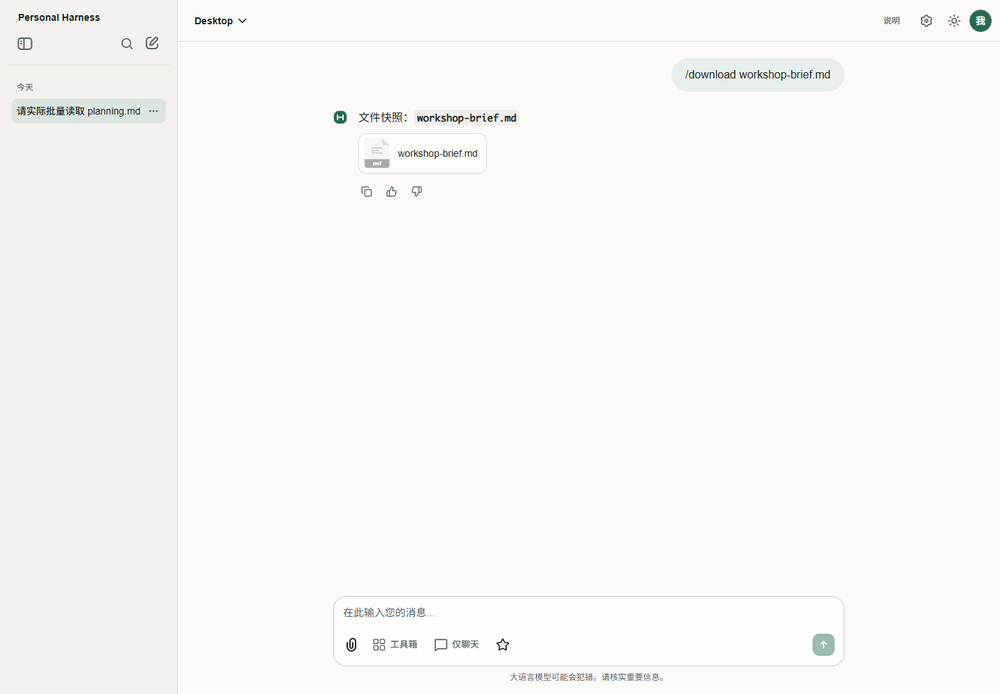
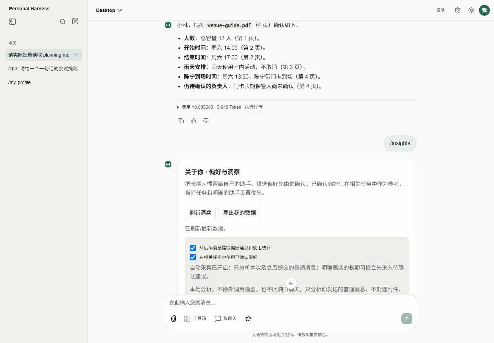
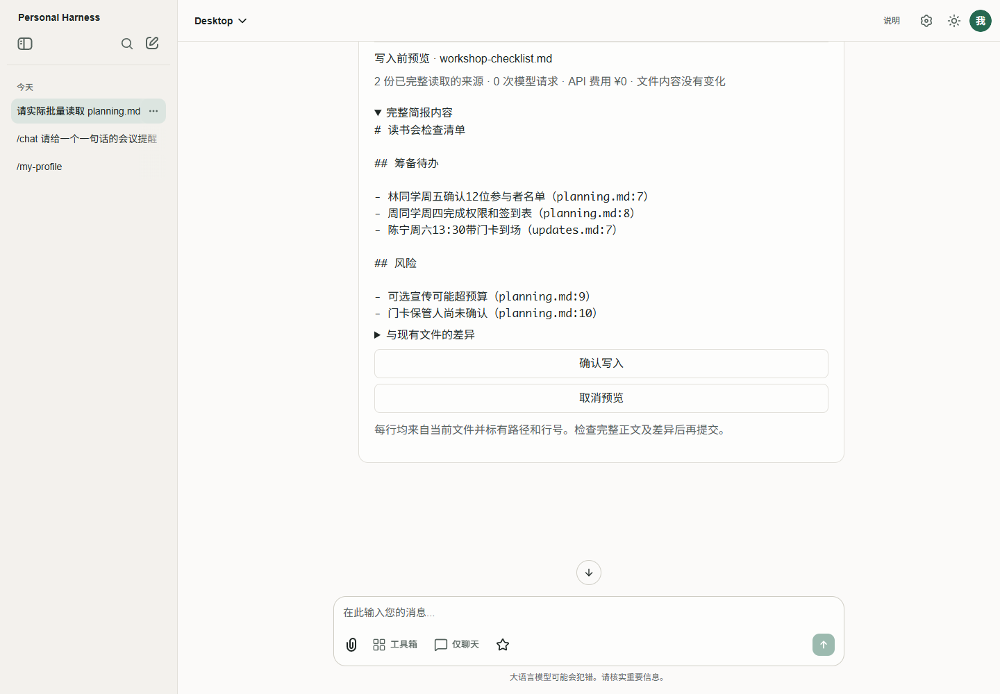
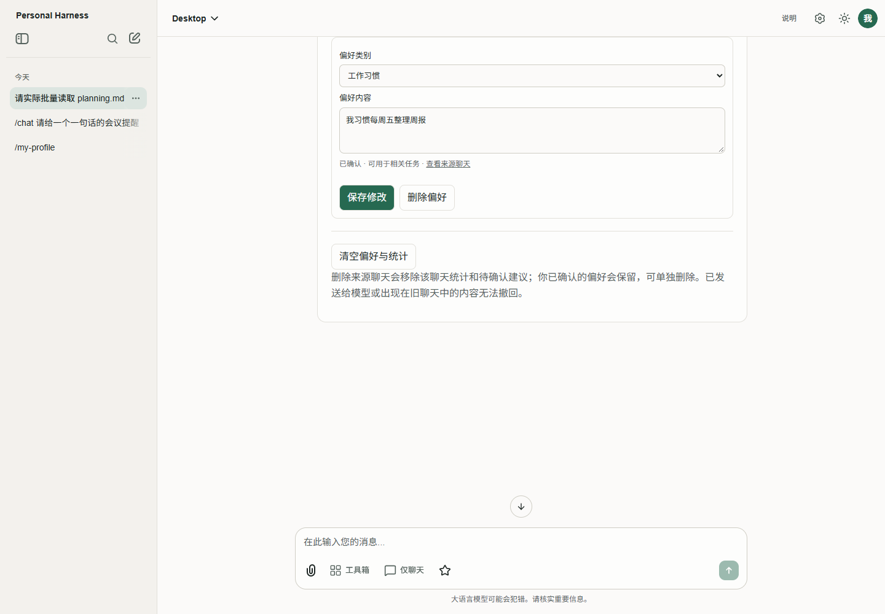

# 综合任务演示：筹备一次社区读书会

这是一次在发布副本 UI 中实际执行的任务：先在本地核对已支出费用，再让在线模型综合三份资料、处理时间冲突，生成可审批的文件；随后上传 PDF、确认长期偏好，并把固定清单保存为不调用模型的个人方案。

全部人名、资料和地点均为虚构示例。截图来自实际明亮模式界面；灰色遮挡用于隐藏测试连接或本机路径，不代表产品字段默认值。图片可点击放大。

## 1. 准备一个干净工作区

先完成[首次登录和连接模型](getting-started.md)。在项目根目录执行：

```sh
uv run python examples/community-workshop/prepare_demo.py --dest ../my-personal-workshop
```

脚本只复制输入文件，不复制参考产物，也不会覆盖已有目录。在设置 →「个人助手」把工作区设为脚本输出的绝对路径。设置 →「我的助手」可填写称呼，例如「小林」。

| 输入资料 | 内容 |
| --- | --- |
| [planning.md](site/demo/planning.md) | 2400 元预算、必须支出、旧结束时间、待办和风险 |
| [expenses.csv](site/demo/expenses.csv) | 三笔已支付费用：450、250、200 元 |
| [updates.md](site/demo/updates.md) | 最新结束时间 17:30、人数、雨天和门卡安排 |
| [venue-guide.pdf](site/demo/venue-guide.pdf) | 4 页可提取文字的场地说明，用于后续附件验证 |

在「工具」中授权 `workspace.read_many`、`workspace.write_preview`、`workspace.write`。点击确认，等待保存完成后重新打开设置，把这三个工具加入「下一轮实际使用的工具」（界面字段 `Tools for next task`）。本地 CSV、搜索和待办功能还需授权 `workspace.read`、`workspace.search` 等相应只读工具。



授权决定可以做什么；下一轮选择决定本次把哪些工具交给模型。写入授权并不替代每次文件审批。

## 2. 先用本地工具核对支出

在聊天中输入：

```text
/sum expenses.csv amount
```

结果应为 3 条、合计 **900.00 元**。这是确定性 CSV 汇总，不调用模型；可保存为自己的快捷查询，下次运行会重新读取当前文件。



## 3. 让 Agent 综合资料并生成简报

正常发送以下消息，**不要加 `/chat`**。`/chat` 表示本轮只聊天，不给模型工作区工具；附件任务可以用它，工作区读取和写入任务不能用它。

```text
请实际批量读取 planning.md、expenses.csv、updates.md，为社区读书会生成中文 Markdown 执行简报，写到 workshop-brief.md。
需要：核算总预算、已支出、必须追加支出后的余额，以及可选宣传的超支缺口；使用最新变更覆盖旧时间；列出12人、雨天安排、三位负责人的待办和明确日期；门卡保管人缺失就标待确认。
每项标注来源文件。先结论后清单，不要猜测未给信息。请调用文件工具提交写入审批，不要仅在聊天贴正文。
```

等待时可展开原生折叠步骤，查看模型请求、读取和写入预览等执行状态。需要写入时，Agent 展示完整拟写正文和差异。



## 4. 审阅、批准与下载

重点核对以下事实，再点击 **Apply write**：

| 核对点 | 正确结果 |
| --- | --- |
| 已支出 | 450 + 250 + 200 = 900 元 |
| 必须支出后的余额 | 2400 − 900 − 600 − 500 = **400 元** |
| 若追加宣传 | 再支付 800 元，超预算 **400 元** |
| 时间冲突 | 采用 updates.md 的 **17:30**，覆盖 planning.md 的旧时间 18:00 |
| 人数与雨天 | 12 人；雨天转室内，不取消 |
| 待办 | 林同学周五、周同学周四、陈宁周六 13:30 |
| 缺失信息 | 门卡保管人仍标为待确认 |



批准前目标文件不存在；批准后才生成 `workshop-brief.md`。如果不满意可点 **Reject**，修改要求后重新生成。预览之后文件发生变化时，必须重新预览，不能沿用旧批准。



本次多文件任务实际完成 4 次模型请求，按接口 usage 与测试连接价格计量为 **¥0.0151056**；费用包括生成、工具往返和批准后的最终回复。金额只代表此次运行，不是不同供应商或任务的统一报价。

输入 `/download workshop-brief.md` 下载。你可以对照[这次实际产物](site/demo/workshop-brief.md)查看；这是参考结果，不是固定模板，不同模型措辞可能不同。`/export` 还可以导出聊天 Markdown。



## 5. 继续上传 PDF，并保留连续上下文

把 `venue-guide.pdf` 拖进聊天或点击回形针上传，再发送：

```text
/chat 我习惯每周五整理周报。请根据4页PDF用中文确认人数、开始与结束时间、雨天安排、陈宁到场时间，以及仍待确认的负责人；叫我的称呼，分点回答。
```

应提到 12 人、14:00–17:30、雨天室内、陈宁 13:30 和待确认的门卡保管人。PDF 先在本机提取文字；这里没有开放额外工具。侧栏可新建其他聊天，再切回原聊天查看附件和记录。



## 6. 让重复步骤不再消耗模型

发送 `/reports`，建立「读书会检查清单」：

```text
来源文件（每行一个）：
planning.md
updates.md

章节配置（每行一个）：
筹备待办 | TODO:
风险 | RISK:

输出文件：workshop-checklist.md
```

保存后点击「读取当前资料并预览」，核对原文及来源行号，最后点击「确认写入」。以后资料中的 TODO 或 RISK 更新，直接重新运行该方案即可。这个步骤本机完成、0 次模型请求；它只分组原文，不承担自由语义摘要。



## 7. 保存使用习惯，查看这轮成本

如需采集使用习惯，先在 `/insights` 开启「从后续消息提取偏好建议和使用统计」，再发送明确的长期偏好。上面的「每周五整理周报」会成为待确认建议；点击「确认采用」后才用于后续适配。关闭自动采集也能手动添加、编辑和删除偏好。



每个在线任务下方都有费用收据，展开可查看模型请求和工具执行；`/usage` 看本聊天记录，`/budget` 看剩余额度。本地汇总、个人方案、场景和偏好维护不发模型请求。这里展示的是减少不必要的调用，不把模型供应商的缓存折扣计作 Harness 的贡献。

这次演示验证了金额、冲突处理、来源、审批前后文件状态和下载内容。它不能证明所有模型都会成功；遇到工具协议或网络问题，请保留错误收据，先检查设置，避免盲目重跑。
