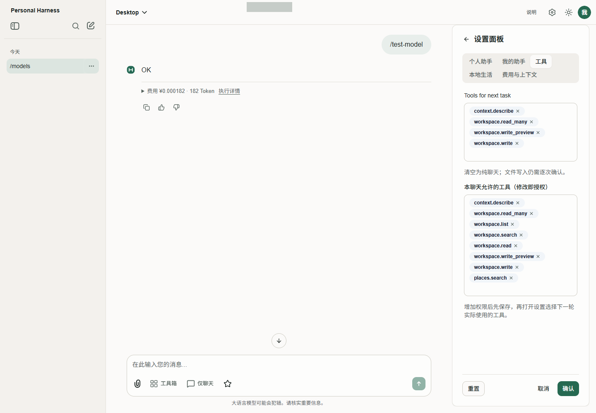
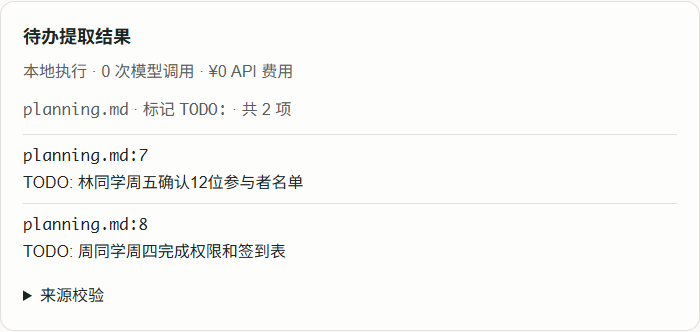
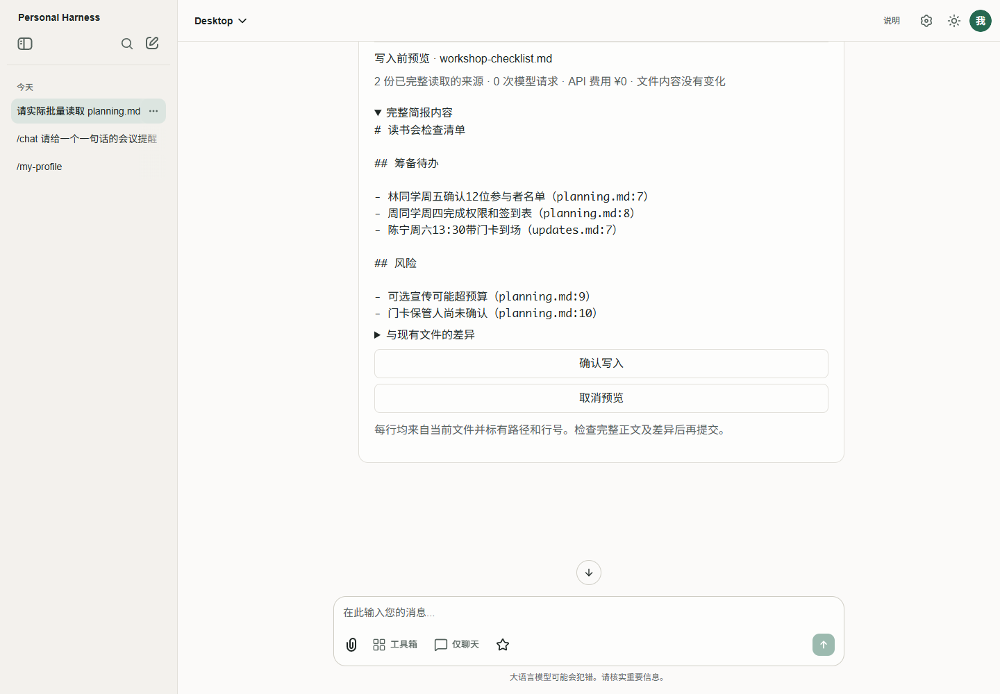

# 电脑 cowork 与本地任务

## 授权范围

工作区路径由你显式设置。文件工具检查路径边界、符号链接、文件类型和大小；写入可额外限制到已有的输出子目录。不提供通用 Shell，也不会执行模型生成的命令。

工具分为「本聊天允许的工具」和「下一轮实际使用的工具」。增加前者就是授权；后者只能在已授权范围内选择。更改工具选择不必重建整个 Agent。

修改授权后先点击确认，等待设置面板关闭再重开，选择下一轮实际使用的工具。普通消息可以调用所选工具；`/chat` 会禁用本轮工具。

## 检索、读取和修改

先搜索相关文件，再按行读取，比把整个目录灌给模型更可控。批量读取可启用 `workspace.read_many`；只读工具并发可设为 1–16。工具返回分页正文和下一页位置，模型需按任务继续读取，截断不会伪装成完整结果。

`workspace.write`、`workspace.replace_text` 最终都需要预览和审批。写入使用文件指纹校验，预览之后源文件或目标发生变化会拒绝落盘；重新生成预览再批准。

## 不需要模型的任务

以下命令在本机执行，API 费用为零，仍检查权限和当前文件：

| 命令 | 用途 |
| --- | --- |
| `/find 关键词` | 本地搜索工作区文本 |
| `/lookup expenses.csv id INV-1` | CSV 按列精确查找 |
| `/sum expenses.csv amount` | CSV 精确合计、均值、条数 |
| `/actions notes.md TODO:` | 提取明确行首标记，保留行号 |
| `/files` | 查看授权目录 |
| `/download brief.md` | 下载允许的文本产物 |

工具箱提供相应表单，可命名保存快捷查询。下次点击会重新读取当前资料，不直接复用过期答案。

## 个人任务方案

`/reports` 打开方案库。配置来源路径、输出路径，以及「章节标题 | 精确行前缀」。可先从来源识别可用标记，再保存并预览。

例如把 `TODO:` 和 `RISK:` 原文分组生成每周简报：读取、整理和预览都无需模型，点击「确认写入」后才落盘。它适合结构明确的重复任务；不承担语义摘要或改写。每次运行会复查源文件和目标指纹。

完整的资料、提示词、审批截图和实际产物见[综合任务演示](task-demo.md)。
